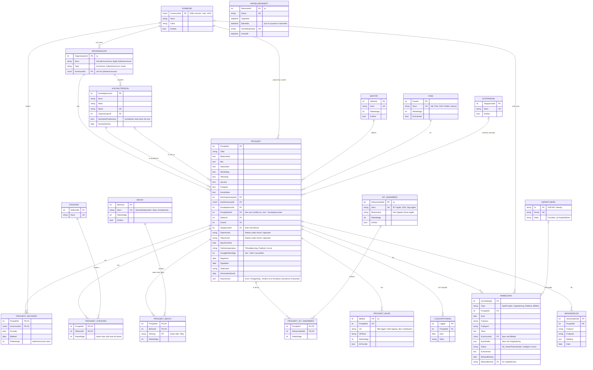

# ER-diagram for KI-kart Agder

Dette dokumentet viser hvordan dataene i KI-kartet henger sammen. Først kommer prototypen slik den er i dag, og deretter hvordan dataene skal ligge i databasen. ER står for entitet–relasjon (entity–relationship).

Diagrammene er skrevet i Mermaid, som GitHub viser som figurer direkte i nettleseren.

**Versjon 2.** Del 5 viser hva som er endret siden første versjon.

## 1. Prototypen i dag

I prototypen ligger alt i minnet og leses inn fra `Data/prosjekter.json`. Den har bare fire klasser, og mye av informasjonen ligger som tekst eller lister inne i `Prosjekt`, for eksempel sektor, fase, deltakerkommuner og stikkord.

```mermaid
erDiagram
    PROSJEKT ||--o{ INNMELDING : "får"
    PROSJEKT ||--o{ HENVENDELSE : "får"
    PROSJEKT ||--|| KONTAKTPERSON : "har kontakt og eier (innebygd)"
    PROSJEKT ||--o{ LOGGOPPFORING : "har (innebygd liste)"

    PROSJEKT {
        int Id PK
        string Tittel
        string Eier "fritekst, f.eks. Arendal kommune"
        string Kommune "plassering i kartet"
        list Deltakere "liste med kommunenavn"
        string Sektor "tekst fra Katalog"
        string Fase "tekst fra Katalog"
        string Stopp "tekst, bare ved Avbrutt"
        list Stikkord "liste med tekst"
        list IktSamarbeid "IKT Agder, DDV, Digi Agder"
        list Soker "liste med behov"
        list Tilbyr "liste med behov"
        object Prosjekteier "den som meldte inn, innebygd Kontaktperson"
        bool Apen
        string Mal_Beskrivelse_Status_osv "flere tekstfelt"
        string Fungerte
        string Annerledes
        date Registrert
        date Oppdatert
        string SistEndret
        bool TilGodkjenning
        date PaminnelseSendt
    }
    KONTAKTPERSON {
        string Navn
        string Rolle
        string Epost
    }
    LOGGOPPFORING {
        date Dato
        string Tekst
    }
    INNMELDING {
        int Id PK
        string Type "NyttProsjekt, Oppdatering, Rettelse, BliMed"
        int ProsjektId FK
        date Dato
        string Fra
        string Tekst
        string Kommune "bare ved BliMed"
        object NyeVerdier "en hel kopi av Prosjekt"
        string Status "Ny, VenterPaInnsender, Godkjent, Avvist"
        string Kommentar
        date BehandletDato
    }
    HENVENDELSE {
        int ProsjektId FK
        string Fra
        string Melding
        date Dato
    }
```

Dette er greit for en prototype, men gir problemer i en ekte løsning:

- **Samme verdi skrives på mange måter.** «Arendal kommune» i `Eier` og «Arendal» i `Deltakere` er ikke koblet sammen. En skrivefeil gir en ny «kommune».
- **Lister inne i én rad kan ikke telles godt i Power BI.** Et spørsmål som «hvor mange prosjekter er Vennesla med i?» krever egne koblingstabeller.
- **Kodelistene ligger i C#-koden** (`Katalog.cs`). En ny sektor krever en ny versjon av programmet.

## 2. Databasen

Kodelistene er egne tabeller, og alle mange-til-mange-forhold har egne koblingstabeller. Kolonnene har samme navn som egenskapene i C#-klassene, slik at EF Core kan koble dem uten ekstra oppsett. Tabeller merket *ny* finnes ikke i prototypen.

`VARSELABONNENT` står alene. Den hører til knappen «Følg» på forsiden, ikke til et bestemt prosjekt.

Tabellnavnene i SQL Server blir flertall av klassenavnene, som `Prosjekter`, `Kommuner` og `Innmeldinger`, fordi EF Core bruker navnet på `DbSet` i `KiKartDbContext`.

## 3. Fra prototype til database

| I prototypen | I databasen |
|---|---|
| `Prosjekt.Eier` (tekst) | `ORGANISASJON`, koblet med `EierOrganisasjonId` |
| `Prosjekt.Kommune` (tekst) | `KartKommuneNr` mot `KOMMUNE` |
| `Prosjekt.Deltakere` (liste) | `PROSJEKT_DELTAKER`, med `ErLeder` for kommunen som leder |
| `Prosjekt.Sektor`, `Fase`, `Stopp` (tekst) | `SEKTOR`, `FASE`, `STOPPARSAK` |
| `Prosjekt.Stikkord` (liste) | `STIKKORD` og `PROSJEKT_STIKKORD` |
| `Prosjekt.Soker` og `Tilbyr` (to lister) | `PROSJEKT_BEHOV` med `Retning`. Fritekst under «Annet» i `SokerAnnet` og `TilbyrAnnet` |
| `Prosjekt.IktSamarbeid` (liste) | `IKT_SAMARBEID` og `PROSJEKT_IKT_SAMARBEID` |
| `Prosjekt.Prosjekteier` (innebygd) | `ProsjekteierId` mot `KONTAKTPERSON` |
| `Prosjekt.Kontakt` (innebygd) | `KONTAKTPERSON`, kan være kontakt for flere prosjekter |
| `Prosjekt.TilGodkjenning` (ja/nei) | `Publiseringsstatus` |
| `Utvalgte` i JSON-filen | `UtvalgtRekkefolge` på prosjektet |
| `Prosjekt.Samarbeid` (regnes ut) | Lagres ikke. Regnes ut som mer enn én rad i `PROSJEKT_DELTAKER` |
| `Innmelding.Fra` og `Henvendelse.Fra` | `FraNavn` og `FraEpost` |
| `Katalog.cs` | Kodelistetabellene |
| Kartet i `agder.json` (nøkkel = kommunenavn) | Kartflatene får `KommuneNr`, se del 4 |
| Finnes ikke | `PROSJEKT_BILDE`, `ASPNETUSERS` (innlogging i Forvaltning), `VARSELABONNENT` |

## 4. Valg og ting å diskutere

- **`Samarbeid` lagres ikke.** Det følger av antall deltakere. Lagres det i tillegg, kan de to verdiene bli uenige.
- **`NyeVerdier` er JSON** (JavaScript Object Notation). En oppdatering kan endre mange felt, også lister. Det er enklere å lagre hele forslaget samlet til det godkjennes enn å lage egne tabeller for forslag. Ulempen er at databasen ikke sjekker innholdet.
- **Kommunenummer som nøkkel.** SSB-numrene (Statistisk sentralbyrå) er standarden som Power BI og andre kilder bruker. De endres ved kommunesammenslåinger, og da må tabellen oppdateres.
- **Kartet må bruke kommunenummer.** `Data/agder.json` bruker i dag kommunenavn som nøkkel, for eksempel `"Birkenes"`. Kartflatene får `KommuneNr`, slik at kartet og databasen kobles på nummer og ikke på navn som kan skrives forskjellig.
- **Innlogging via ASP.NET Identity.** Forvalterne lagres i Identity-tabellene (`AspNetUsers`, `AspNetRoles`), ikke i en egen brukertabell med passord. Bruker Digi Agder Microsoft-kontoer, kan innloggingen gå via dem i stedet.
- **Samtykke.** Kontaktinformasjon vises bare på kartet når `SamtykkePublisering` er satt. Det offentlige grensesnittet sjekker dette før navn og e-post vises.
- **Bilder.** Bildefilene lagres i blob-lagring. Databasen har bare adressen (`Url`), alternativ tekst for skjermlesere og hvilket bilde som vises på forsiden.
- **Varsler.** Et abonnement gjelder først når e-posten er bekreftet (`Bekreftet`). Hver e-post har en avmeldingslenke med `AvmeldingToken`.
- **Personopplysninger.** Navn og e-post til kontaktpersoner, innsendere og abonnenter er personopplysninger etter GDPR (personvernforordningen). Det må være klart hvor lenge de lagres, og avviste innmeldinger og avmeldte abonnenter bør slettes etter en fast tid.
- **Power BI.** Power BI bør lese fra denne databasen, ikke være databasen. Koblingstabellene gjør at deltakere, stikkord og behov kan telles og filtreres direkte i Power BI.
- **Endringshistorikk.** `LOGGOPPFORING` viser bare en kort tekst om hva som ble endret. Trenger Digi Agder å vite nøyaktig hvilke felt som ble endret og av hvem, må det lages en mer detaljert historikktabell.

### Åpent spørsmål

**Er kommunen i kartet alltid den som leder?** `KartKommuneNr` på prosjektet og `ErLeder` i `PROSJEKT_DELTAKER` kan peke på forskjellige kommuner. Er de alltid den samme, bør `KartKommuneNr` fjernes og kartet bruke lederkommunen. Ellers beholdes begge.

## 5. Endringer fra første versjon

| Endring | Hvorfor |
|---|---|
| Ny tabell `PROSJEKT_BILDE` | Prosjektene skal kunne vise bilder på forsiden |
| `BRUKER` erstattet av `ASPNETUSERS` | ASP.NET Identity håndterer passord og innlogging sikkert, `BehandletAvId` er nå tekst |
| `SamtykkePublisering` og `SamtykkeDato` på `KONTAKTPERSON` | Kontaktinfo skal bare vises med samtykke |
| `FraNavn` og `FraEpost` på `HENVENDELSE` | Digi Agder må kunne svare på henvendelsen |
| `RowVersion` på `PROSJEKT` | Hindrer at to forvaltere overskriver hverandres endringer |
| `Bekreftet` og `AvmeldingToken` på `VARSELABONNENT` | Ingen kan melde på andre, og alle kan melde seg av |
| `ErAktiv` og `Rekkefolge` på kodelistene | En verdi kan skjules fra filtrene uten at gamle prosjekter mister koblingen |
| Kolonnenavn i PascalCase (`ProsjektId`, ikke `prosjekt_id`) | Samme navn som i C#, så EF Core trenger ikke ekstra oppsett |
| Kommunenummer i kartet | `agder.json` bruker navn, databasen bruker nummer |
| `Rekkefolge` på `PROSJEKT_DELTAKER`, `PROSJEKT_STIKKORD` og `PROSJEKT_BEHOV` | Kartet viser ofte bare de første stikkordene og kommunene. Rekkefølgen innsenderen valgte må tas vare på |
| Ny kodeliste `IKT_SAMARBEID` med `PROSJEKT_IKT_SAMARBEID` | Prosjekter kan være en del av IKT Agder, DDV eller Digi Agder (fra PR #3) |
| `ProsjekteierId` på `PROSJEKT` | Den som meldte inn, kan bekrefte prosjektet og får påminnelser (fra PR #3) |
| `SokerAnnet` og `TilbyrAnnet` på `PROSJEKT` | Skjemaet har «Annet» med fritekst. Kodelisten `BEHOV` holdes ren (fra PR #2) |
