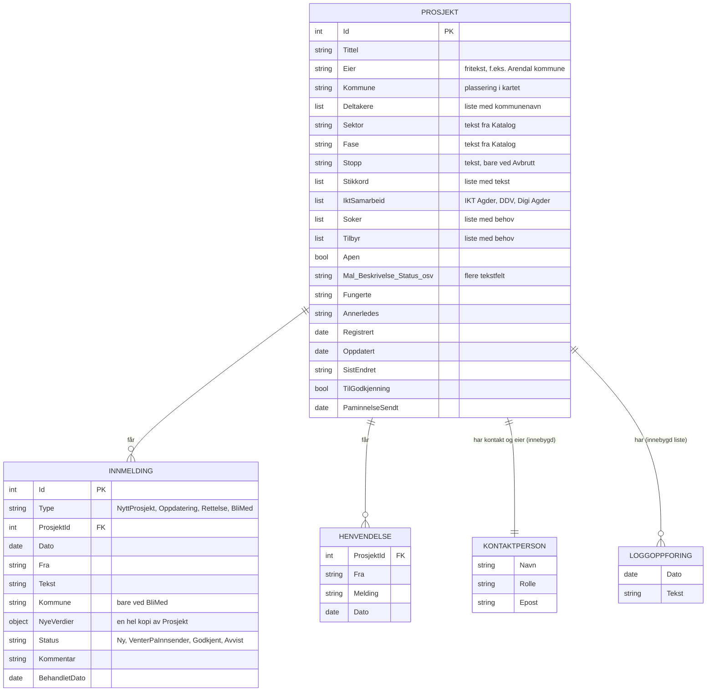
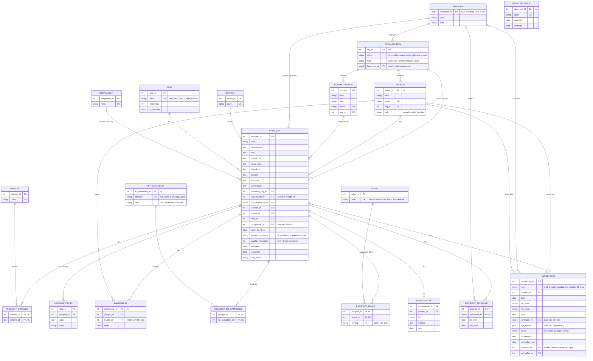

# ER-diagram for KI-kart Agder

Dette dokumentet viser hvordan dataene i KI-kartet henger sammen, først slik de ligger i prototypen i dag, og så hvordan de bør ligge i en database. ER står for entitet–relasjon (entity–relationship).

Diagrammene er skrevet i Mermaid, som GitHub viser som figurer direkte i nettleseren.

## 1. Prototypen i dag

I prototypen ligger alt i minnet og leses inn fra `Data/prosjekter.json`. Det er bare fire klasser. Mye av informasjonen ligger som tekst eller lister inne i `Prosjekt`, for eksempel sektor, fase, deltakerkommuner og stikkord.

Dette er greit for en prototype, men gir problemer i en ekte løsning:

- **Samme verdi skrives på mange måter.** «Arendal kommune» i `Eier` og «Arendal» i `Deltakere` er ikke koblet sammen. En skrivefeil gir en ny «kommune».
- **Lister inne i én rad kan ikke telles godt i Power BI.** Spørsmål som «hvor mange prosjekter har Vennesla med i samarbeid?» krever egne koblingstabeller.
- **Kodelistene ligger i C#-koden** (`Katalog.cs`). En ny sektor krever ny versjon av programmet.

## 2. Fremtidig database

Her er kodelistene egne tabeller, og alle «mange til mange»-forhold har egne koblingstabeller. Tabeller merket med «ny» finnes ikke i prototypen.

`VARSELABONNENT` står alene. Den er knyttet til knappen «Følg» på forsiden, ikke til et bestemt prosjekt.

## 3. Fra prototype til database

| I prototypen | I databasen |
|---|---|
| `Prosjekt.Eier` (tekst, ansvarlig kommune) | `ORGANISASJON`, koblet med `ansvarlig_org_id` |
| `Prosjekt.Prosjekteier` (den som meldte inn) | `BRUKER`, koblet med `eier_bruker_id` |
| `PaminnelseSendt` | `PAMINNELSE`, én rad per utsendelse |
| Aktiv eller inaktiv (regnes ut) | Lagres ikke. Regnes ut fra `oppdatert` |
| `Prosjekt.Kommune` (tekst) | `kart_kommune_nr` mot `KOMMUNE` |
| `Prosjekt.Deltakere` (liste) | `PROSJEKT_DELTAKER`, med `er_leder` for kommunen som leder |
| `Prosjekt.Sektor`, `Fase`, `Stopp` (tekst) | `SEKTOR`, `FASE`, `STOPPARSAK` |
| `Prosjekt.Stikkord` (liste) | `STIKKORD` og `PROSJEKT_STIKKORD` |
| `Prosjekt.IktSamarbeid` (liste, valgfri) | `IKT_SAMARBEID` og `PROSJEKT_IKT_SAMARBEID` |
| `Prosjekt.Soker` og `Tilbyr` (to lister) | `PROSJEKT_BEHOV` med `retning` |
| `Prosjekt.Kontakt` (innebygd) | `KONTAKTPERSON`, kan være kontakt for flere prosjekter |
| `Prosjekt.TilGodkjenning` (ja/nei) | `publiseringsstatus` |
| `Utvalgte` i JSON-filen | `utvalgt_rekkefolge` på prosjektet |
| `Prosjekt.Samarbeid` (regnes ut) | Lagres ikke. Regnes ut som flere enn én rad i `PROSJEKT_DELTAKER` |
| `Katalog.cs` | Kodelistetabellene |
| Finnes ikke | `VARSELABONNENT` |

## 4. Eierskap og aktualitet

- **Den som melder inn, blir eier.** Ved et nytt prosjekt settes `eier_bruker_id` til brukeren som sendte innmeldingen (`innsendt_av`). Eieren kan oppdatere og bekrefte prosjektet og får påminnelser. `KONTAKTPERSON` er den som vises utad, og kan være en annen person.
- **Eier og ansvarlig er to forskjellige ting.** `ansvarlig_org_id` er kommunen eller virksomheten som står bak. `eier_bruker_id` er personen som har ansvaret for at informasjonen er riktig.
- **Fargen ved «sist oppdatert»** regnes ut fra `oppdatert`: grønn de første 6 månedene, gul fra 6 til 11 måneder og oransje den siste måneden før fristen.
- **Påminnelse.** Etter 11 måneder får eieren en påminnelse om å bekrefte eller oppdatere prosjektet. DigiAgder kan også sende den manuelt, for eksempel til eiere av inaktive prosjekter. Hver utsendelse lagres i `PAMINNELSE`, så DigiAgder kan se hvem som har fått beskjed og når.
- **Inaktiv lagres ikke.** Et prosjekt er inaktivt når det har gått mer enn 12 måneder siden `oppdatert`, og det ikke er fullført eller avbrutt. Når eieren bekrefter eller oppdaterer, flyttes `oppdatert` til dagens dato, og prosjektet er aktivt igjen. Inaktive prosjekter tas ikke med på oversikten, i kartet eller i Power BI-tallene, men erfaringene deres er fortsatt søkbare.

## 5. Valg og ting å diskutere

- **IKT-samarbeid er valgfritt** og kan være flere. Derfor en koblingstabell, ikke et felt på prosjektet. Hvilke kommuner som er med i hvert IKT-samarbeid, er ikke lagret. Det kan legges til som en egen koblingstabell mellom `KOMMUNE` og `IKT_SAMARBEID` hvis Power BI skal vise det.
- **Eierskap når folk slutter.** Når eieren slutter i kommunen, får ingen påminnelsene. DigiAgder bør kunne overføre eierskap til en annen bruker, og kommunen bør kanskje ha en fast reserve.
- **`samarbeid` lagres ikke.** Det følger av antall deltakere. Lagres det i tillegg, kan de to verdiene bli uenige.
- **`nye_verdier` er JSON** (JavaScript Object Notation). En oppdatering kan endre mange felt, også lister. Det er enklere å lagre hele forslaget samlet til det godkjennes, enn å lage egne tabeller for forslag. Ulempen er at databasen ikke sjekker innholdet.
- **Kommunenummer som nøkkel.** SSB-numrene (Statistisk sentralbyrå) er standarden Power BI og andre kilder bruker. De endres ved kommunesammenslåinger, og da må tabellen oppdateres.
- **Personopplysninger.** Navn og e-post til kontaktpersoner og innsendere er personopplysninger etter GDPR (personvernforordningen). Det må være klart hvor lenge de lagres, og avviste innmeldinger og avmeldte abonnenter bør slettes etter en fast tid.
- **Power BI.** Power BI bør lese fra denne databasen, ikke være databasen. Koblingstabellene gjør at deltakere, stikkord og behov kan telles og filtreres direkte i Power BI.
- **Endringshistorikk.** `LOGGOPPFORING` viser bare en kort tekst om hva som ble endret. Trenger DigiAgder å vite nøyaktig hvilke felt som ble endret og av hvem, må det lages en mer detaljert historikktabell.
